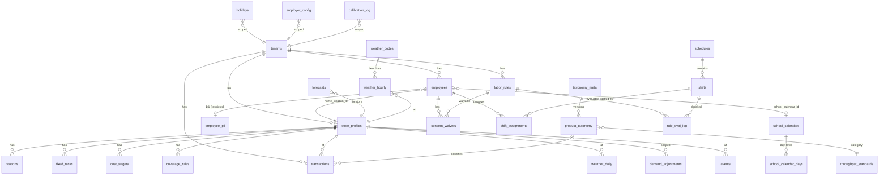

# PostgreSQL schema & ERD — Coffee Shop Scheduler (F47 / CS-047)

**Status:** Draft · **Owner:** TBD · **Date:** 2026-11-12
**Decision:** the schema is **multi-tenant-ready from day one** — every domain table carries `tenant_id`
and is protected by Row-Level Security, with `maven-demo` as the sole seed tenant. The SaaS features
(F60–F70) then add auth/billing/admin *around* an already-isolated core rather than reworking every table.
See [`../../PLAN.md`](../../PLAN.md) and [`architecture/saas-multi-tenancy.md`](./architecture/saas-multi-tenancy.md).

This document is the canonical contract. **Alembic migrations under `coffee-scheduler/db/` are generated
from this schema, not the other way round.** It supersedes the `.xlsx` workbooks as the source of truth;
the workbooks become ETL inputs (F44) and export targets (F46).

---

## 1. Conventions

### 1.1 Tenancy & isolation (applies to every *domain* table)
- Every domain table has `tenant_id UUID NOT NULL REFERENCES tenants(id) ON DELETE CASCADE`.
- Every domain table: `ENABLE` **and** `FORCE ROW LEVEL SECURITY`, with a policy
  `USING (tenant_id = current_setting('app.tenant_id', true)::uuid)` **and** the same `WITH CHECK`.
- The application connects as a **non-owner** role (`app_rw` / `app_ro`) without `BYPASSRLS`; only the
  `migrator` role bypasses RLS (migrations + ETL). `current_setting(..., true)` returns NULL when unset,
  so a query with no tenant context matches **zero rows** (fail-closed).
- Every index and every former global `UNIQUE` is **prefixed with `tenant_id`**, so two tenants can reuse
  the same natural key (`rule_id`, `location_id`, …) independently.
- **Exceptions (global, no `tenant_id`, no RLS):** `tenants`, `weather_codes` (WMO standard lookup).

### 1.2 Naming & types
- Tables & columns: `snake_case`, plural table names. Surrogate PKs are `UUID DEFAULT gen_random_uuid()`
  except where a stable natural/business key already exists (`rule_id`, `location_id`, `product_id`,
  `transaction_id`, `weather_code`) — those are kept and scoped by `tenant_id`.
- Money: `NUMERIC(10,2)`. Rates/multipliers: `NUMERIC`. Times: `TIME`; timestamps: `TIMESTAMPTZ`.
- Booleans are real `BOOLEAN`. Controlled vocabularies use `CHECK (… IN (…))` or native `ENUM` where the
  set is stable (see each table). Loose/extensible config uses `JSONB`.
- Ages are **never stored** — `employees.dob` only; age is computed on the shift date (carried over from the
  single-tenant PII rule).

### 1.3 Effective-dating (temporal tables)
Tables whose rows are valid over a date window use a half-open range and a GiST exclusion constraint so two
overlapping versions of the same key cannot coexist:
```sql
validity daterange NOT NULL DEFAULT daterange(effective_from, effective_to, '[)'),
EXCLUDE USING gist (tenant_id WITH =, <natural_key> WITH =, validity WITH &&)
```
Applies to: `labor_rules`, `consent_waivers`, `school_calendar`, `events`. (`holidays` is keyed by date, no
overlap possible.)

### 1.4 Partitioning (high-volume tables)
`PARTITION BY RANGE` on the time column, monthly partitions, created ahead by a maintenance job:
- `transactions` → `transaction_date`
- `weather_hourly` → `date`
- `rule_eval_log` → `evaluated_at`

A partitioned table's primary key **must include the partition key**, so those PKs are composite
(e.g. `transactions (tenant_id, transaction_id, transaction_date)`).

### 1.5 Roles
| Role | Grants | Used by |
|---|---|---|
| `migrator` | owner + `BYPASSRLS` | Alembic migrations, ETL (F44) |
| `app_rw` | `SELECT/INSERT/UPDATE/DELETE` on domain tables, **no** `BYPASSRLS` | Solver, manager UI, write paths |
| `app_ro` | `SELECT` only | Labor-Compliance agent, analytics, read paths |
| `secrets_rw` | DML on `employee_pii` / future `tenant_secrets` only | the narrow path that needs PII/secrets |

---

## 2. ERD



> The ERD is grouped for readability; `tenant_id` FKs to `tenants` are implicit on **every** domain table
> and omitted from the diagram to keep it legible. `weather_codes` and `tenants` are the only global tables.

---

## 3. Tables

Each table lists its source sheet, columns, PK, FKs (with `ON DELETE`), indexes, and any RLS/partition/
temporal notes. `tid` = `tenant_id UUID NOT NULL REFERENCES tenants(id) ON DELETE CASCADE` (RLS-protected),
stated once per table rather than repeated.

### 3.1 `tenants` *(root; global, no RLS)*
Source: SaaS plan (new). | PK `id UUID`.
| col | type | notes |
|---|---|---|
| id | UUID PK | `gen_random_uuid()` |
| slug | TEXT UNIQUE NOT NULL | URL-safe; reserved-slug denylist enforced in app |
| name | TEXT NOT NULL | |
| status | TEXT NOT NULL | `CHECK IN ('trial','active','suspended','churned')` |
| plan | TEXT NOT NULL DEFAULT 'starter' | `CHECK IN ('starter','pro','enterprise')` |
| jurisdiction | TEXT NOT NULL DEFAULT 'NY-STATE+NYC' | drives rule-engine lookup |
| timezone | TEXT NOT NULL DEFAULT 'America/New_York' | IANA tz |
| created_at | TIMESTAMPTZ NOT NULL DEFAULT now() | |
| settings | JSONB NOT NULL DEFAULT '{}' | non-secret config only |

Seed row: `maven-demo` (`active`, `pro`, `NY-STATE+NYC`).

### 3.2 `employer_config`
Source: `coffee_shop_labor_rules.xlsx!Employer_Config`. | PK `(tenant_id, employer_id)`.
`employer_id, employer_name, jurisdiction, wage_order, fww_covered BOOLEAN, chain_location_count INT, notes`.
RLS. Index `(tenant_id, employer_id)`.

### 3.3 `store_profiles`
Source: `labor_standards!Store_Profile`. | PK `(tenant_id, location_id, day_of_week)`.
`location_id INT, store_location TEXT, day_of_week TEXT CHECK(Mon..Sun), open_time TIME, close_time TIME,
pre_open_minutes INT, post_close_minutes INT, max_staff_on_floor INT, stations INT, profile_type TEXT,
basis TEXT`. `first_staff_in`/`last_staff_out` are **generated columns**
(`open_time - pre_open_minutes` / `close_time + post_close_minutes`). RLS. FK targets for stations/tasks/etc.
> Store identity (`location_id` → name, floor/station counts) is logically distinct from the per-day hours
> grid; both live here for parity with the workbook. A future split into `stores` + `store_hours` is noted
> but not required for CS-047.

### 3.4 `stations`
Source: `labor_standards!Stations`. | PK `(tenant_id, station_id)`.
`station_id, location_id INT, store_location TEXT, station_type TEXT, staffed_by_role TEXT`.
FK `(tenant_id, location_id)` → `store_profiles.location_id` (`ON DELETE CASCADE`). RLS.

### 3.5 `fixed_tasks`
Source: `labor_standards!Fixed_Tasks`. | PK `(tenant_id, task_id)`.
`task_id, location_id INT, task TEXT, role TEXT, duration_minutes INT, timing TEXT, frequency TEXT, basis TEXT`.
FK location. RLS.

### 3.6 `coverage_rules`
Source: `labor_standards!Coverage_Rules`. | PK `(tenant_id, rule_id)`.
`rule_id TEXT, location_id INT NULL, description TEXT, value TEXT, unit TEXT, basis TEXT`. `location_id` NULL = all
stores. RLS. Cross-ref: F26 reconciliation with `labor_rules`.

### 3.7 `shift_rules`
Source: `labor_standards!Shift_Rules`. | PK `(tenant_id, rule_id)`.
`rule_id TEXT, description TEXT, value TEXT, unit TEXT, basis TEXT`. RLS.

### 3.8 `cost_targets`
Source: `labor_standards!Cost_Targets`. | PK `(tenant_id, location_id)`.
`location_id INT, store_location TEXT, target_labor_pct_of_sales NUMERIC, weekly_overtime_budget_usd NUMERIC(10,2),
understaffing_penalty_weight NUMERIC, premium_penalty_weight NUMERIC, basis TEXT`. FK location. RLS.

### 3.9 `throughput_standards`
Source: `labor_standards!Throughput_Standards`. | PK `(tenant_id, product_category)`.
`product_category TEXT, prep_role TEXT, items_sold_jan_jun_2023 INT, seconds_per_unit NUMERIC,
units_per_labor_hour NUMERIC, basis TEXT, notes TEXT`. Includes the `(per transaction overhead)` pseudo-row.
RLS. Coverage invariant with `product_taxonomy.product_category` (BUG-002 guard → DB `CHECK`/trigger or ETL assert).

### 3.10 `demand_adjustments`
Source: `labor_standards!Demand_Adjustments`. | PK `(tenant_id, adjustment_id)`.
`adjustment_id TEXT, trigger_type TEXT, condition TEXT, location_id INT NULL, demand_multiplier NUMERIC,
staff_delta INT, applies_hours TEXT, basis TEXT, notes TEXT`. RLS. `demand_multiplier` `CHECK BETWEEN 0.5 AND 1.5`.

### 3.11 `product_taxonomy`
Source: `labor_standards!Product_Taxonomy` (CS-009). | PK `(tenant_id, product_id)`.
`product_id INT, product_detail TEXT, product_type TEXT, product_category TEXT, taxonomy_version TEXT`.
FK `(tenant_id, taxonomy_version)` → `taxonomy_meta`. RLS. `product_id → product_category` is a function
(enforced by PK + app/ETL assert, per F29.AC2).

### 3.12 `taxonomy_meta`
Source: `labor_standards!Taxonomy_Meta`. | PK `(tenant_id, taxonomy_version)`.
`taxonomy_version TEXT, source_period TEXT, generated_on DATE, n_products INT, n_types INT, n_categories INT`. RLS.

### 3.13 `calibration_log`
Source: `labor_standards!Calibration_Log` (CS-008). | PK `(tenant_id, calibration_id)`.
`calibration_id TEXT, "table" TEXT, row_key TEXT, planned_value TEXT, observed_value TEXT, sample_period TEXT,
proposed_value TEXT, approved_by TEXT, approved_on DATE, notes TEXT`. **Append-only** (no UPDATE/DELETE grant
to `app_rw`). RLS.

### 3.14 `employees`
Source: `coffee_shop_staff.xlsx!Staff` (PII removed). | PK `(tenant_id, employee_id)`.
`employee_id INT, first_name TEXT, last_name TEXT, sex TEXT, dob DATE, role TEXT CHECK IN('Barista','Register','Shift lead'),
skill_level INT CHECK(1..3), home_location_id INT, cross_location_eligible BOOLEAN, is_key_holder BOOLEAN,
cash_authorised BOOLEAN, food_protection_cert BOOLEAN, hourly_rate NUMERIC(10,2), availability_persona TEXT,
min_hours_week INT, max_hours_week INT CHECK(min<=max), is_enrolled BOOLEAN, school_calendar_id TEXT NULL,
grade_band TEXT CHECK IN('HS','College','None'), has_other_employer BOOLEAN`.
FKs: `(tenant_id, home_location_id)` → `store_profiles`; `(tenant_id, school_calendar_id)` → `school_calendars`
(NULL iff not enrolled, `CHECK (is_enrolled = (school_calendar_id IS NOT NULL))`). RLS.
Legality `CHECK`s (minor never key-holder; minor weekly caps) carried from `validate_roster_fields.py`.

### 3.15 `employee_pii` *(restricted)*
Source: `data/private/coffee_shop_staff_pii.xlsx`. | PK `(tenant_id, employee_id)`; FK → `employees` (`ON DELETE CASCADE`).
`ssn TEXT, line1 TEXT, line2 TEXT, city TEXT, state TEXT, zipcode TEXT` (encrypted at rest; app-level
envelope encryption for `ssn`). Separate RLS + **separate grant**: only `secrets_rw`/`migrator` read it; `app_rw`/`app_ro`
have **no** grant. Supports employee-level right-to-be-forgotten (F69).

### 3.16 `labor_rules` *(temporal)*
Source: `labor_rules!Labor_Rules`. | PK `(tenant_id, rule_id, effective_from)`.
28 cols: `rule_id, rule_category, jurisdiction, wage_order, enforcement, applies_age_min INT, applies_age_max INT,
applies_school_status, applies_day_type, applies_season, requires_employer_flag, metric, operator, value_num NUMERIC,
value_time TIME, value_text, unit, consequence, waivable_by_consent BOOLEAN, waiver_doc_required BOOLEAN, priority INT,
effective_from DATE, effective_to DATE NULL, source_citation, source_url, verification_status, verified_on DATE, notes`.
Temporal: `validity daterange` + `EXCLUDE USING gist (tenant_id =, rule_id =, validity &&)` — no overlapping versions of a rule.
RLS. Index `(tenant_id, jurisdiction, rule_category)`.

### 3.17 `consent_waivers` *(temporal)*
Source: `labor_rules!Consent_Waivers`. | PK `(tenant_id, waiver_id)`.
`waiver_id TEXT, employee_id INT, rule_id TEXT, document_type TEXT, valid_from DATE, valid_to DATE NULL, doc_reference TEXT, notes TEXT`.
FKs employee, rule. `EXCLUDE (tenant_id =, employee_id =, rule_id =, validity &&)` — one active waiver per employee×rule. RLS.

### 3.18 `rule_eval_log` *(partitioned, append-only)*
Source: `labor_rules!Rule_Eval_Log`. | PK `(tenant_id, eval_id, evaluated_at)`; **PARTITION BY RANGE (evaluated_at)** monthly.
`eval_id UUID, schedule_id UUID, shift_id UUID, employee_id INT, rule_id TEXT, result TEXT CHECK IN('PASS','FAIL','PREMIUM','WARN'),
premium_cost_usd NUMERIC(10,2), evaluated_at TIMESTAMPTZ, agent TEXT, notes TEXT`. FKs employee/rule/shift. Append-only. RLS.
Index `(tenant_id, rule_id, result)`, `(tenant_id, shift_id)`.

### 3.19 `school_calendars` + `school_calendar_days`
Source: `labor_rules!School_Calendar`. Split the flat sheet into a header (`school_calendars`: PK
`(tenant_id, calendar_id)`, `calendar_source, source_url, effective_from, effective_to, is_assumption, notes`)
and day rows (`school_calendar_days`: PK `(tenant_id, calendar_id, date)`, `in_session BOOLEAN, day_before_school_day BOOLEAN`).
FK days→header. Temporal on the header (`validity`). RLS. *(If a flat table is preferred for ETL parity, keep one
`school_calendar` table keyed `(tenant_id, calendar_id, date)` — note the choice in CS-047's plan.)*

### 3.20 `holidays`
Source: `labor_rules!Holiday_Calendar`. | PK `(tenant_id, holiday_id)`.
`holiday_id TEXT, date DATE, holiday TEXT, jurisdiction TEXT, calendar_source, source_url, effective_from DATE,
effective_to DATE NULL, is_assumption BOOLEAN, notes TEXT`. Index `(tenant_id, date, jurisdiction)`. RLS.

### 3.21 `transactions` *(partitioned)*
Source: `coffee_shop_sales.xlsx` (~149k rows). | PK `(tenant_id, transaction_id, transaction_date)`;
**PARTITION BY RANGE (transaction_date)** monthly.
`transaction_id BIGINT, transaction_date DATE, transaction_time TIME, transaction_qty INT, store_id INT,
store_location TEXT, product_id INT, unit_price NUMERIC(10,2), product_category TEXT, product_type TEXT, product_detail TEXT`.
FKs: `(tenant_id, store_id)`→`store_profiles.location_id`; `(tenant_id, product_id)`→`product_taxonomy`.
RLS. Index `(tenant_id, store_id, transaction_date)`, `(tenant_id, product_id)`.

### 3.22 `weather_hourly` *(partitioned)*
Source: `weather_forecast.xlsx!Hourly_Sales_Weather` (~9k rows). | PK `(tenant_id, location_id, date, hour)`;
**PARTITION BY RANGE (date)**. Columns per sheet (`temperature_2m … weather_bucket, in_trading_hours`, plus the
joined `line_items/items/revenue`). `weather_code` FK → `weather_codes`. RLS.

### 3.23 `weather_daily`
Source: `weather_forecast.xlsx!Daily_Sales_Weather` (543 rows). | PK `(tenant_id, location_id, date)`.
`line_items, items, revenue NUMERIC(10,2), temp_max_f, temp_min_f, temp_mean_f, precip_in, snow_in, max_wind_mph,
rain_hours INT, dominant_weather TEXT`. FK store. RLS. (Feeds CS-008 calibration.)

### 3.24 `weather_codes` *(global reference; no RLS)*
Source: `weather_forecast.xlsx!Weather_Codes`. | PK `weather_code INT`. `description TEXT, bucket TEXT`. WMO standard — shared across tenants.

### 3.25 `events` *(temporal; new, F50/CS-050)*
Per-store effective-dated events feeding the forecaster/solver. PK `(tenant_id, event_id)`.
`event_id UUID, location_id INT, event_type TEXT, title TEXT, start_at TIMESTAMPTZ, end_at TIMESTAMPTZ,
demand_multiplier NUMERIC, status TEXT CHECK IN('active','cancelled'), source TEXT`. Cancellation closes the row
(status) rather than deleting. `EXCLUDE` on overlap per store+type optional. RLS.

### 3.26 Solver output — `schedules`, `shifts`, `shift_assignments`, `forecasts` *(new)*
Referenced by `rule_eval_log`; produced by the solver (F11) and forecaster (F8/F12).
- `schedules` — PK `(tenant_id, schedule_id UUID)`; `location_id, week_start DATE, status, created_at, solver_version`.
- `shifts` — PK `(tenant_id, shift_id UUID)`; FK schedule; `location_id, station_id, start_at, end_at, role`.
- `shift_assignments` — PK `(tenant_id, shift_id, employee_id)`; FK shift + employee; `is_meal_break_covered BOOLEAN`.
- `forecasts` — PK `(tenant_id, forecast_id UUID)`; `location_id, product_category, forecast_hour TIMESTAMPTZ,
  p70 NUMERIC, lower NUMERIC, upper NUMERIC, model_version, taxonomy_version` (consumes CS-009/CS-012 contract).
All RLS; indexes `(tenant_id, location_id, week_start/forecast_hour)`.

### 3.27 Derived / QA (materialized views, not base tables)
- `hourly_demand` (from `transactions`) ← `labor_standards!Hourly_Demand`: a **materialized view** aggregating
  line-items/items per `(location_id, day_of_week, hour_start)`; refreshed after ETL/ingest.
- `hours_validation` ← `labor_standards!Hours_Validation`: a **view** asserting trading inside operating hours
  (QA, not source data). `Store_Profile` generated columns + this view replace the workbook's manual sheet.
- `Summary` / `Data_Dictionary` / `Schema` / `README` / `Out_of_Scope` sheets are **not** migrated — they are
  workbook documentation, superseded by this file.

---

## 4. Mapping the current `validate_*.py` invariants to the database

The xlsx-era guarantees become DB constraints (checked by Postgres) or post-load ETL assertions (F44):

| Invariant (today) | Becomes |
|---|---|
| roster: `min_hours_week ≤ max_hours_week`; minor never key-holder; minor weekly caps | `CHECK` constraints on `employees` |
| roster: `school_calendar_id` set iff enrolled | `CHECK (is_enrolled = (school_calendar_id IS NOT NULL))` + FK |
| per-store feasibility (≥3 key-holders, ≥2 skill-3 baristas, ≥4 FPC) | ETL post-load assertion (aggregate; not a row constraint) |
| taxonomy: `product_id → category` is a function; sales ⊆ throughput (BUG-002) | PK on `product_taxonomy` + FK `transactions.product_id`; `throughput` coverage ETL assert |
| calibration: append-only audit; basis ∈ {ASSUMPTION,CALIBRATED} | append-only grant; `CHECK` on `basis` |
| weather multiplier ∈ [0.5,1.5] | `CHECK` on `demand_adjustments.demand_multiplier` |
| labor-rule effective-date non-overlap | `EXCLUDE USING gist` on `labor_rules` |
| every rule has a `rule_id`; every transaction a valid `store_id` | `NOT NULL` + FK |

ETL (F44) runs the aggregate assertions that cannot be expressed as row constraints and reports per-table
row counts, mirroring the current validators' PASS/FAIL reports.

---

## 5. Open decisions for CS-047 review
1. **`store_profiles` shape** — keep the flat per-day grid (workbook parity) vs split into `stores` + `store_hours`.
2. **`school_calendar`** — normalized header+days (§3.19) vs one flat table (ETL parity).
3. **Surrogate vs natural PKs** — this draft keeps business keys (`rule_id`, `location_id`, `product_id`,
   `transaction_id`) scoped by `tenant_id`; confirm before generating migrations.
4. **Partition granularity** — monthly assumed; the 6-month fixture fits a handful of partitions, but confirm
   the maintenance job that pre-creates future partitions.
5. **`weather_hourly`/`weather_daily` ownership** — they currently embed joined sales columns; decide whether
   to keep the denormalized join or derive sales aggregates via a view.

Resolve these in the CS-047 plan, then generate the first Alembic revision from this schema.
